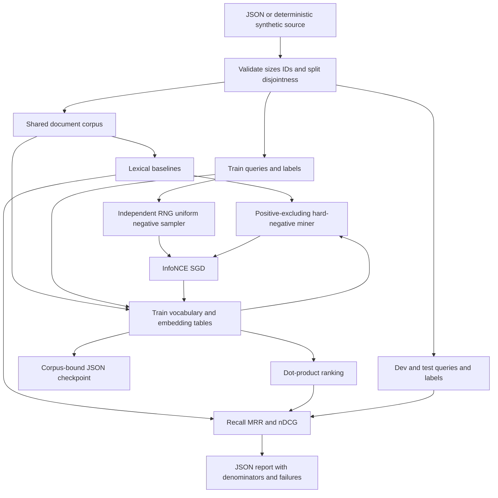

# Encoder and ranking pipeline

The original encoder/training path below remains available. The implemented token-level MaxSim and IVF search path is specified in [maxsim-and-partitions.md](maxsim-and-partitions.md), with actual benchmarks in [late-interaction-results.md](late-interaction-results.md).

## Contracts

`data.py` owns the input contract and dataset fingerprint. Document IDs must be unique, labels must refer to existing IDs, query IDs and normalized text must be disjoint across train/development/test, and all splits must be nonempty. The corpus is shared and visible, which is explicit transductive corpus access rather than held-out-document evaluation. Training consumes only the `train` tuple, never the Dataset object or held-out labels.

`retrieval.py` owns deterministic tokenization, TF-IDF cosine, Jaccard similarity, tie breaking, and positive-safe hard mining. The miner ranks the bounded corpus before excluding every relevant ID. A query with multiple relevant documents cannot accidentally turn another known positive into a negative.

`model.py` owns encoder weights, mean pooling, real InfoNCE derivatives, seeded SGD, mining snapshots, training bounds, checkpoint validation, and an optional lazy pretrained adapter. Mean pooling is differentiable; both independent tables learn. The checkpoint records actual tables and is bound to exact corpus text/IDs. Corpus changes require retraining or an explicit new checkpoint.

`metrics.py` owns binary-relevance Recall@k, truncated MRR@k, and nDCG@k. All rates name their cutoffs and include query/label denominators. Duplicate ranking IDs are errors. There is no LLM grader and no answer-quality metric because no answer generator exists.

Cutoffs must be nonempty, valid, and unique; otherwise repeated cutoffs could double-count a metric. Ranked scores must be finite. Reports retain per-query ranked IDs and metric contributions so aggregation can be recomputed. Finite input vectors that overflow during dot products or gradient calculations fail explicitly rather than returning NaN.

The optional random-negative ablation shares initialization and query-update order with hard mining. A separate RNG samples without replacement after excluding all positives. Both strategies receive only training labels. CLI checkpoint reuse additionally matches the recorded training-query fingerprint, so a mismatched split cannot silently be presented as the configured benchmark.

`__main__.py` wires the experiment. Default evaluation trains on the declared training split, evaluates development and test separately, and prints/saves machine-readable results. It never chooses a hyperparameter using test performance. `--config`, `--epochs`, and `--seed` are explicit operator settings, recorded in every report.

## Failure and trust boundaries

Imported corpus and query text is inert data, not executable instructions. Nothing in this project reads credentials, calls external tools, or executes text. Filesystem writes are limited to the output/checkpoint paths explicitly selected by the caller. The optional pretrained adapter is the only component that may contact an external model hub and is never imported on the core path.

Malformed schema, excessive data, duplicate query text/IDs, unknown labels, missing negatives, out-of-budget training, nonfinite losses, invalid checkpoint weights, or corpus mismatch raise errors. The CLI returns exit status 2 with `experiment_failed` and the validation reason; it never writes fabricated success metrics. Raw library exceptions remain useful during development. Unknown-only model queries return an empty ranking.

Training has bounded iteration count, candidates, features, dimensions, and vocabulary. It runs synchronously on the CPU; no wall-clock cancellation, service concurrency limit, or hosted request timeout is claimed. The default data is entirely synthetic. Reports log dataset and train-label fingerprints, configuration, loss by epoch, negative counts, and failure IDs. Deployments handling private data must add access controls and an explicit logging/redaction policy.

## Verification

Unit tests independently verify query and document gradients using finite differences, exact multi-positive metric arithmetic, stable softmax math, split-leakage rejection, unknown labels, positive-safe mining, actual learning, reproducibility, OOV behavior, checkpoint corruption, and corpus binding. Default CLI evaluation reports 32 development and 64 held-out-template test queries. The checked-in synthetic results are reproducible but intentionally narrow; recurring intent aliases make them unsuitable as evidence of open-domain retrieval quality.
