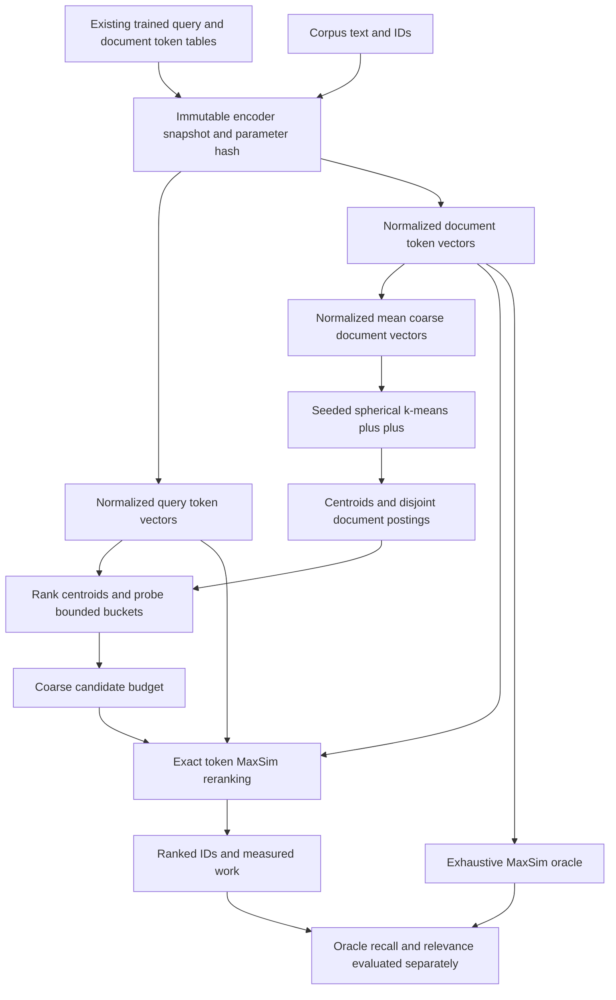

# Learned-token late interaction and IVF candidate search

`late_interaction.py` implements a frozen encoder snapshot, exhaustive MaxSim, spherical k-means++ coarse indexing, bounded probing, and exact candidate reranking. Everything runs in the standard library on a CPU.

## Encoder reuse and scoring

The original model actually trains separate query/document token embeddings with a mean-pooling InfoNCE objective. This upgrade reuses those learned tables, normalizes every token vector, and freezes copied state. It does **not** claim contextual transformer embeddings, ColBERT training, or a new supervised MaxSim objective.

For query token vectors q_i and document vectors d_j:

`score(Q,D) = sum_i max_j dot(q_i,d_j)`.

Every query occurrence contributes once. Document tokens remain separate until the per-query-token maximum; they are not collapsed to one similarity score before reranking. Negative similarities remain negative. Unknown tokens are dropped explicitly, and an entirely unknown query returns no hits. The score is not calibrated confidence. Exact ties sort by document ID.

Exhaustive cost is O(sum_documents |Q| |D| dimension); cached token storage is O(total_document_tokens * dimension). Each query has an explicit 20-million scalar multiply-add budget, checked before scoring. Reports count token dot products exactly; those counts exclude Python validation/lookup overhead and are not reported as CPU instruction counts.

## Learned coarse partition

Each document's coarse vector is the unit-normalized mean of its normalized token vectors. Spherical k-means++ initializes centroids with seeded distance-weighted selection, alternates cosine assignments and normalized centroid means, and persists final assignments using the actual final centroids. Empty clusters are retained explicitly rather than dropping documents. Training has a work bound that includes both initialization and assignment passes.

Postings partition the corpus: each document belongs to exactly one centroid. This is a document-level IVF-style coarse index, not a token-compression or distributed ANN engine.

At query time:

1. Form the query coarse vector.
2. Rank all coarse centroids, then probe `nprobe` buckets.
3. Rank the union by coarse document similarity and retain at most `max_candidates`.
4. Compute the exact same MaxSim function used by exhaustive search for those candidates.
5. Sort the reranked results by score and ID.

Probe and candidate budgets are independent. More probes cannot recover a good document removed by a small candidate budget. Full probing with the full candidate budget must exactly reproduce exhaustive rankings; the benchmark and tests enforce that invariant.

With C centroids and P candidate documents before truncation, coarse work is C+P dot products; reranking uses only the retained candidates. Sorting adds O(C log C + P log P). The index saves interaction work, but it has no universal latency advantage: full probing adds coarse overhead to exhaustive scoring.

## Artifact binding and consistency

An index is bound to the exact corpus fingerprint and a frozen encoder fingerprint incorporating raw query/document parameter tables, vocabulary, dimension, and normalized scoring state. Even a parameter change that happens to preserve normalized directions changes the source-model binding. Later mutation of the source Python model cannot alter an already frozen retriever.

Loading uses bounded JSON, never executable serialization. It validates schema version, finite unit-or-zero centroid vectors, unique corpus-complete postings, and every document's nearest-centroid assignment. A stale model/corpus or corrupted partition fails instead of yielding a plausible result. These hashes detect mismatch; they do not authenticate an attacker-controlled trainer or artifact.

## Two different recall questions

**Oracle recall@5** measures the fraction of exhaustive MaxSim's top-five IDs recovered by approximate search. **Ground-truth relevance@1** measures whether the first result actually satisfies the labeled task. They cannot be substituted for each other.

The challenge corpus includes relation-swapped documents with identical token multisets. A non-contextual token-MaxSim model cannot distinguish which color has which permission, even under exhaustive search. The benchmark interleaves those questions with alias tasks so a small query limit cannot hide the difficult slice. It reports both slices and raw rankings. An index can agree perfectly with an imperfect scoring oracle.

## Limits and tests

The implementation supports at most 1,000 documents from the existing corpus contract, 128 tokens per text, dimensions up to 128, 64 coarse clusters, explicit probes/candidates, and bounded training/reranking work. It does not add a network service, vector quantization, incremental index mutation, contextual encoding, or a MaxSim training gradient.

Tests include independently calculated MaxSim values, a deliberately adversarial coarse-mean example whose best multi-token match is missed at one probe, full-probe exactness, budget-caused misses, OOV handling, seeded clustering, frozen-state behavior, stale artifacts, and an explicit relation-binding failure.
